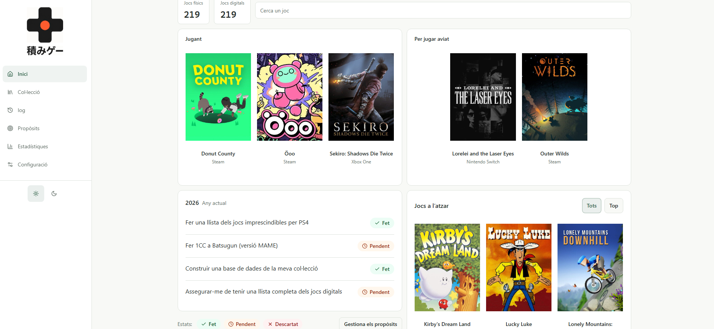
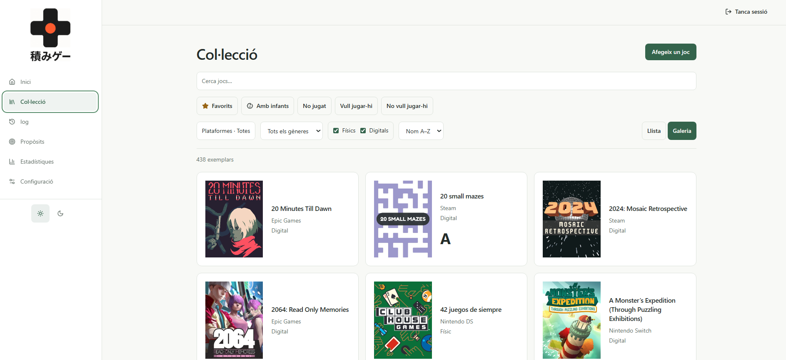
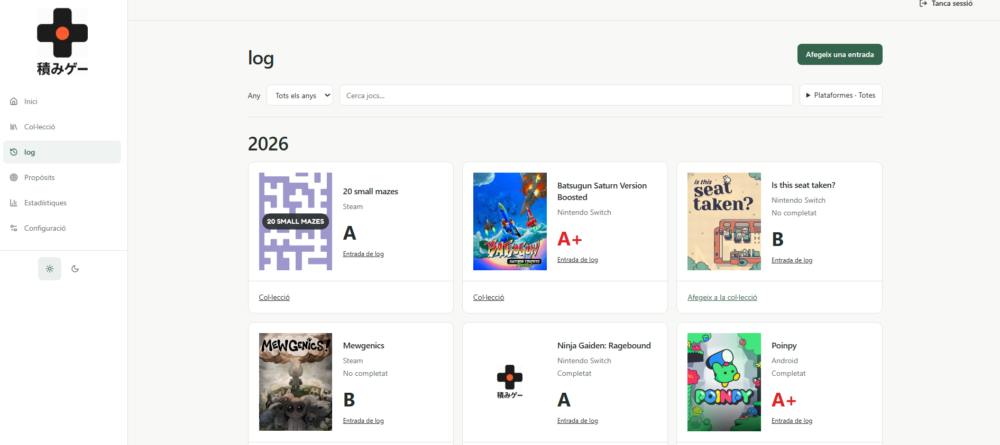
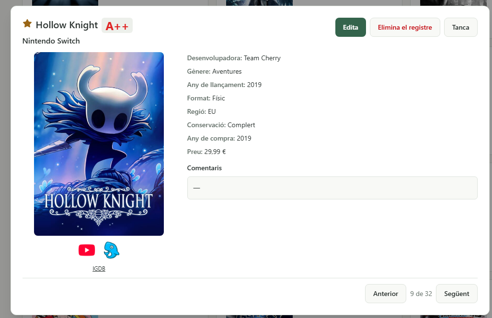

# 積みゲー · Tsumigē

**La teva col·lecció de videojocs i el teu log de joc, en un mateix lloc.**

Organitza els jocs físics i digitals, recorda què has jugat cada any i guarda valoracions, comentaris i propòsits. Una interfície en català, pensada per consultar-la tant a l’ordinador com al mòbil, amb modes clar i fosc.

**[Obre Tsumigē](https://ibelchi.github.io/Tsumige/)** · [Blog de l’autor](https://ibelchi.github.io/)



## Un joc, diferents registres

- **Fitxa de videojoc:** títol, plataforma, portada, gènere, valoració i comentaris compartits. El mateix títol en plataformes diferents correspon a fitxes diferents.
- **Exemplar de col·lecció:** una còpia física o digital, amb les seves dades de compra, regió i conservació.
- **Entrada de log:** l’any de joc i l’estat de completat. Pot referir-se a un joc que no tens a la col·lecció.

Eliminar un exemplar o una entrada de log demana confirmació i conserva la fitxa i els altres registres. La fitxa només es pot eliminar quan ja no té exemplars ni entrades vinculats.

## Què hi trobaràs

- **Inici personal:** cercador de tots els jocs accessibles, Jugant i Per jugar aviat, propòsits anuals i una selecció aleatòria amb Tots/Top.
- **Col·lecció i log en galeria:** portades, plataformes i valoracions; vista llista amb miniatures a Col·lecció i log agrupat per anys. Cerca i filtres per plataforma, format i gènere a Col·lecció, més Favorits o Amb infants; al log, any, cerca i plataformes. Botons de No jugat i Vull jugar-hi / No vull jugar-hi combinables amb els altres filtres.
- **Detalls llegibles:** portada amb marc uniforme i retall centrat, valoració al costat del títol —A+ i A++ en vermell—, comentaris i navegació entre registres. Consulta i edició separades, amb protecció dels canvis sense desar i marques compartides del videojoc.
- **Cerques externes:** portades d’IGDB/RAWG o URL pròpia, i icones per cercar un tràiler a YouTube o el joc a MobyGames. Són cerques externes; no hi ha reproductor incrustat ni pujada de portades pròpies.
- **Seguiment i estadístiques:** propòsits pendents, fets o descartats; distribucions de plataformes, gèneres, compres, anys de joc i valoracions.
- **Revisió de dades:** consulta camps buits de fitxes, exemplars o entrades de log, i obre el detall per revisar-los. Un preu de 0 € és una dada informada.
- **Còpies i exportació:** ZIP amb dades, portades i informe de descàrregues; recuperació amb previsualització i exportació CSV per consultar amb Excel.

## Captures de pantalla

### Col·lecció



### Log



### Detall d’un videojoc



## Accés i privacitat

L’aplicació requereix iniciar sessió; l’enllaç públic no dona accés anònim a la col·lecció. El propietari pot editar i gestionar les dades. Els convidats autoritzats poden consultar-les i triar el tema visual, sense modificar registres. Els permisos també es comproven a Supabase amb polítiques RLS.

El repositori conté el programa, no la base de dades personal ni les còpies de seguretat. Les credencials secretes d’IGDB/Twitch i RAWG es mantenen al servidor.

## Tecnologia

React, TypeScript, React Router, Vite, Tailwind CSS i TanStack Query. Supabase proporciona autenticació, PostgreSQL amb RLS i emmagatzematge privat de portades. Icones de Lucide i còpies ZIP amb fflate. GitHub Actions compila i desplega l’aplicació a GitHub Pages.

## Desenvolupament local

Requereix **Node.js 22** i un projecte Supabase amb l’esquema, les funcions i els permisos adequats; una base buida no és suficient. Consulta [Arquitectura](docs/ARQUITECTURA.md). Els SQL històrics no són un instal·lador i no s’han de repetir sobre la instància existent.

Copia `.env.example` a `.env.local` i configura la URL i una clau **publishable o anon**, mai una clau secreta.

```sh
npm ci
npm run dev
```

Obre `http://127.0.0.1:5173/Tsumige/`. Per comprovar i compilar:

```sh
npm run typecheck
npm run lint
npm run build
```

Les instruccions de proves i publicació són a [Publicació i manteniment](docs/PUBLICACIO.md) i [proves de navegador](tests/browser/README.md). Les comprovacions manuals encara pendents es conserven a [Treball pendent](docs/PENDENTS.md); les proves automàtiques no les substitueixen.

## Autoria i drets

Projecte d’[Israel Belchi](https://github.com/ibelchi).

Els textos i notes propis de l’autor es comparteixen amb **CC BY-NC-SA 4.0**. Aquesta llicència no s’aplica al codi, als logotips ni a les portades de tercers. No s’ha escollit encara una llicència per al codi; les dependències mantenen les seves llicències respectives.

*Observar per crear i enfilar per gaudir. Repetir.*
